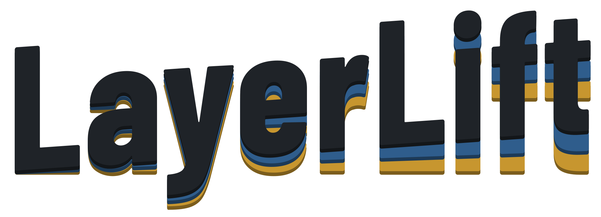

<h1 align="center">
  <picture>
    <source media="(prefers-color-scheme: dark)" srcset="docs/brand/logo-dark.svg">
    
  </picture>
</h1>

Tools for multi-colour 3D printing, each ending in a 3MF that opens in OrcaSlicer with every
part already assigned to its AMS slot:

- **Image to Layers** turns a flat-colour image (logo, badge, icon) into a multi-colour
  relief. Upload an image, list the filaments loaded in your AMS, adjust the colour mapping
  and heights, then download one object with a part per filament.
- **Gridfinity** plans a drawer: a baseplate cut to the drawer and split to fit your bed, and
  bins with dividers, scoops, hexagon walls, lite bases, magnet holes and multi-colour labels.
  See [Gridfinity](#gridfinity).

```
backend/relief/   pure-Python library (no web deps): analysis, mapping, geometry, export
backend/app/      FastAPI service (process pool, job store, static frontend)
backend/tests/    pytest: acceptance tests, unit tests, API tests, Orca round-trip
frontend/         React + Vite + TypeScript UI, three.js 3D preview
frontend/src/gridfinity/ Gridfinity geometry (manifold-3d WASM, in a Web Worker), 3MF export, tests
deploy/k8s/       k3s manifests (Deployment, Service, Traefik Ingress, optional basic auth)
deploy/pocketbase/ PocketBase image + schema migrations, for accounts (optional)
Dockerfile        multi-stage: build frontend, then slim Python 3.12 runtime
docker-compose.yml LayerLift + PocketBase, wired together
```

## Run it

**Container** (what you deploy):

```sh
docker build -t layerlift .
docker run --rm -p 8000:8000 layerlift      # http://localhost:8000
```

**With accounts** (LayerLift + PocketBase, see [Accounts](#accounts-pocketbase)):

```sh
cp .env.example .env                         # set PB_SUPERUSER_PASSWORD and a session secret
docker compose up -d --build                 # http://localhost:8000
```

**Development:**

```sh
cd backend && uv sync                        # Python 3.12 venv + deps
uv run uvicorn app.main:app --reload         # API on :8000
cd frontend && npm install && npm run dev    # UI on :5173, proxies /api to :8000
```

`npm run build` puts the UI in `frontend/dist`, which the API serves automatically.

**Development with accounts:** run a persistent PocketBase in Docker and point the dev API at it.

```sh
# first create .env.dev with the keys listed below
docker compose -f docker-compose.dev.yml --env-file .env.dev up -d --build   # 127.0.0.1:8090, data in a volume
cd backend && uv run uvicorn app.main:app --reload --env-file ../.env.dev
```

`.env.dev` (gitignored) holds `PB_SUPERUSER_EMAIL` / `PB_SUPERUSER_PASSWORD` for the container and
the matching `LAYERLIFT_POCKETBASE_URL=http://127.0.0.1:8090`, `LAYERLIFT_POCKETBASE_SUPERUSER_EMAIL`,
`LAYERLIFT_POCKETBASE_SUPERUSER_PASSWORD` and `LAYERLIFT_SESSION_SECRET` for the API. The dashboard is
at http://localhost:5173/pb/_/. After changing a migration, rerun the `docker compose ... up -d
--build` line.

**Tests:** `cd backend && uv run pytest` (about two minutes), and `cd frontend && npm test`
for the Gridfinity geometry (a few seconds). The OrcaSlicer
round-trip tests (one per tool) run only when OrcaSlicer is installed (set `ORCA_SLICER` to its path if it
is not in the default location). The accounts test against a real PocketBase runs only when
`LAYERLIFT_TEST_POCKETBASE_URL` is set; `tests/test_accounts.py` shows how to start one.

**k3s:** edit `image:` and `host:` in `deploy/k8s/layerlift.yaml`, then
`kubectl apply -f deploy/k8s/layerlift.yaml`. Use a released Docker Hub tag (see below).

## Releases and versioning

`.github/workflows/release.yml` runs on every push to `master` that touches code. It runs
the tests, works out the next version, pushes the image to Docker Hub, then tags the
commit and creates a GitHub release. Nothing is tagged if the tests or the push fail.

Versions follow `MAJOR.MINOR.PATCH[-label]`, starting at `0.0.1-beta`. The bump comes from
the commit messages since the last release, using
[Conventional Commits](https://www.conventionalcommits.org):

| Commits since last release | Bump | Example |
|---|---|---|
| anything else (`fix:`, `chore:`, plain text) | patch | 0.0.1-beta → 0.0.2-beta |
| at least one `feat:` | minor | 0.0.2-beta → 0.1.0-beta |
| `feat!:`, `fix!:` or `BREAKING CHANGE` | major (minor while on 0.x) | 0.1.0-beta → 0.2.0-beta |

The `-beta` label is set by `DEFAULT_PRERELEASE` in the workflow. To publish a stable
version, run the workflow manually (Actions → Release → Run workflow) with pre-release
set to `none`. A patch run promotes the current beta, for example 0.2.0-beta → 0.2.0.
Setting `DEFAULT_PRERELEASE: ''` makes every release stable. Manual runs can also force a
`patch`, `minor` or `major` bump, or use another label such as `rc`.

Docker tags pushed for each release:

- **Pre-release:** `0.0.1-beta`, `beta` (the latest beta), and `sha-<commit>`.
- **Stable:** `1.2.3`, `1.2`, `1`, `latest`, and `sha-<commit>`.

Repository settings needed:

- **Secret `DOCKERHUB_USERNAME`:** your Docker Hub username.
- **Secret `DOCKERHUB_TOKEN`:** a Docker Hub access token with Read & Write scope.
- **Variable `DOCKERHUB_REPOSITORY` (optional):** the image name, if it isn't
  `<username>/layerlift`.

### Configuration

Environment variables, all optional:

| Variable | Default | Meaning |
|---|---|---|
| `LAYERLIFT_MAX_UPLOAD_MB` | 10 | Upload limit |
| `LAYERLIFT_MAX_IMAGE_SIDE` | 1024 | Images are downscaled to this before processing |
| `LAYERLIFT_WORKERS` | 2 | Worker processes (concurrent analyses/builds) |
| `LAYERLIFT_JOB_TIMEOUT_SECONDS` | 180 | A build running longer is killed |
| `LAYERLIFT_JOB_TTL_SECONDS` | 3600 | Build outputs are deleted after this |
| `LAYERLIFT_DATA_DIR` | system temp | Where job directories live |
| `LAYERLIFT_TURNSTILE_SITE_KEY` | empty | Cloudflare Turnstile site key; with the secret key, turns the human check on |
| `LAYERLIFT_TURNSTILE_SECRET_KEY` | empty | Cloudflare Turnstile secret key |
| `LAYERLIFT_SESSION_SECRET` | random at start | Signs session cookies; set it so sessions survive restarts |
| `LAYERLIFT_SESSION_TTL_SECONDS` | 21600 | How long one human check lasts |
| `LAYERLIFT_COOKIE_SECURE` | auto | Force the Secure flag on the session cookie |
| `LAYERLIFT_MAX_QUEUE` | 8 | Jobs running or waiting across everyone; more get "busy, try again" |
| `LAYERLIFT_MAX_JOBS_PER_CLIENT` | 2 | Jobs one client may have running or waiting |
| `LAYERLIFT_RATE_LIMIT_PER_MINUTE` | 12 | Analyses and builds one client may start per minute |
| `LAYERLIFT_MAP_RATE_LIMIT_PER_MINUTE` | 90 | Colour-mapping suggestions per client per minute |
| `LAYERLIFT_CLIENT_IP_HEADER` | empty | Header to read the client IP from, e.g. `CF-Connecting-IP` |
| `LAYERLIFT_ENABLE_DOCS` | false | Serve the API docs at `/api/docs` |
| `LAYERLIFT_POCKETBASE_URL` | empty | PocketBase as LayerLift reaches it, e.g. `http://pocketbase:8090`; turns accounts on |
| `LAYERLIFT_POCKETBASE_SUPERUSER_EMAIL` | empty | Superuser LayerLift signs in as |
| `LAYERLIFT_POCKETBASE_SUPERUSER_PASSWORD` | empty | Its password |
| `LAYERLIFT_POCKETBASE_DASHBOARD` | true | Proxy PocketBase's dashboard at `/pb/_/` |
| `LAYERLIFT_JOB_RECORD_DAYS` | 14 | Job records without stored files are deleted after this |

With accounts on, the rate, job, upload, image-size and timeout limits above are only the
fallback. The tiers in PocketBase set them per visitor.

## Running it on the internet

These protections are built in:

- **Human check.** With Turnstile keys set, visitors pass a Cloudflare Turnstile check
  once. They then get a signed session cookie that lasts 6 hours. Analysing, building
  and colour mapping all need that session.
- **Bounded queue.** Analyses and builds wait for a free worker in arrival order. At most
  `MAX_QUEUE` jobs can be running or waiting; beyond that, requests get `503` with
  `Retry-After` instead of piling up. Each visitor may have `MAX_JOBS_PER_CLIENT` jobs at
  once. Queued builds show their place in line.
- **Rate limits.** Each client IP may start `RATE_LIMIT_PER_MINUTE` analyses and builds
  per minute; excess requests get `429` with `Retry-After`.
- **Limits already in place:** 10 MB uploads, images scaled down to 1024 px, a 180 s build
  timeout that kills the worker, and outputs deleted after an hour.
- **Security headers:** a Content-Security-Policy that allows only this site and Turnstile,
  plus `nosniff`, `DENY` framing and a strict referrer policy. The API docs are off.

To set it up:

1. In the Cloudflare dashboard, open Turnstile and add a widget for your LayerLift
   hostname. Copy the site key and the secret key.
2. Create the Kubernetes secret from `deploy/k8s/secrets.example.yaml`. It holds both keys
   plus a random `LAYERLIFT_SESSION_SECRET`.
3. Put the site behind Cloudflare, ideally with a Cloudflare Tunnel so the origin is not
   reachable directly. A Cloudflare WAF rate-limiting rule on `/api/*` adds a second layer
   in front of the app's own limits.

**Client IPs.** The image trusts `X-Forwarded-For` only from private addresses, such as
Traefik and the pod network. The IP used for limits is therefore the one your proxy saw,
and a visitor can't fake it. Set `LAYERLIFT_CLIENT_IP_HEADER=CF-Connecting-IP` only if
your proxy chain loses the real address, and only when the origin accepts traffic from
Cloudflare alone. Otherwise anyone could forge that header.

**Capacity.** Measured on the 512 px sample image, the container idles at about 270 MB,
and each build running at the same time adds about 250 MB. A build takes about
11 seconds. Larger images need more, so the manifest's 3 GiB limit leaves headroom for
the default 2 workers. Raise `LAYERLIFT_WORKERS` and the memory limit together.

## Accounts (PocketBase)

Accounts are optional. Set `LAYERLIFT_POCKETBASE_URL` (the compose file does) and LayerLift
uses [PocketBase](https://pocketbase.io) for sign-in, per-account limits, live job records
and saved builds. Without it, everyone is a guest with the limits from the environment,
exactly as before.

- **One origin.** LayerLift proxies PocketBase at `/pb`, including its realtime event stream
  and its dashboard at `/pb/_/`. PocketBase needs no public port, CORS setup or ingress of its
  own. Set `LAYERLIFT_POCKETBASE_DASHBOARD=false` to stop proxying the dashboard.
- **Sign-in.** Email and password, with open sign-up. Google, GitHub and other providers
  appear on the sign-in form as soon as you enable them in the PocketBase dashboard
  (Collections > users > Options > OAuth2). Their redirect URL is
  `https://<your host>/pb/api/oauth2-redirect`. Password reset and email verification need
  SMTP, set in the dashboard under Settings > Mail.
- **Tiers.** Limits live in the `tiers` collection and take effect within 30 seconds of an
  edit in the dashboard. Each tier sets the analyses and builds allowed per minute, the jobs
  at once, the upload size, the image size, the build timeout, and how long finished builds are
  kept. `anonymous` applies to guests, `free` to accounts without a tier, and `supporter` is an
  example to assign by hand (users > the account > tier). Signed-in accounts skip the
  Turnstile check, and their limits count per account rather than per IP. The server-wide
  `LAYERLIFT_MAX_QUEUE` and `LAYERLIFT_WORKERS` still cap everyone together.
- **My builds.** Every analysis and build writes a `jobs` record with its stage and
  progress, updated live. For accounts whose tier keeps builds, the finished preview, GLB,
  3MF and STL zip are uploaded to the record. The owner can re-download them from
  *My builds* until the record expires. Files are protected: only the owner, using a
  short-lived token, can fetch them. Records without files (analyses, guests' builds) are
  deleted after `LAYERLIFT_JOB_RECORD_DAYS`.
- **Admin page** (`#/admin`, for accounts with `role = admin`, set in the dashboard) shows
  workers, the queue and every running or waiting job with its account, IP and tier, all
  updating live. It can cancel a build that is still waiting; a running build can only be
  stopped by its timeout. The IP is a hidden field, which only superusers can read in
  PocketBase.
- **The schema** is in `deploy/pocketbase/pb_migrations/` and is applied on start. The
  image's entrypoint also creates (or updates) the superuser LayerLift signs in with, from
  `PB_SUPERUSER_EMAIL` and `PB_SUPERUSER_PASSWORD`. Back up the `pb_data` volume: it holds
  the accounts and saved builds.

If PocketBase is unreachable, LayerLift keeps working. Everyone gets the environment's
limits, and job records are skipped (a warning is logged).

Each release also publishes `<image>-pocketbase` (the `deploy/pocketbase` image) with the same
version tag, so PocketBase's schema always matches the app. To run it on Kubernetes, give it one
replica with `Recreate` and a volume at `/pb/pb_data`. Set `PB_SUPERUSER_EMAIL`,
`PB_SUPERUSER_PASSWORD` and `PB_APP_URL` (e.g. `https://layerlift.example.com/pb`), then point
LayerLift's three `LAYERLIFT_POCKETBASE_*` variables at its Service. The k3s manifests in
`deploy/k8s` don't include it yet.

## Gridfinity

The Gridfinity tool (`#/gridfinity`) builds everything in the browser. The geometry is
[manifold-3d](https://github.com/elalish/manifold) compiled to WebAssembly, running in a Web
Worker, so the 3D preview updates as you type (a bin takes 50 to 300 ms) and the server does no
work at all: no queue, no rate limits, no jobs.

- **Start screen.** Open a saved project, or start a drawer project, a single bin or a single
  baseplate. A drawer project can hold several baseplates (a toolbox with a few drawers, say).
- **Drawer planner.** Size a baseplate in cells (6 × 6), or enter a drawer's inside size. The grid fills it, the spare room becomes
  a solid margin (on both sides, or one), and the baseplate is split into pieces that fit your
  printer's bed. Drag across empty cells to add a bin, drag a bin to move it (in the layout or
  across the baseplate in the 3D drawer view), drag its corner to resize it. Bins that overlap, run off the grid, are bigger than the bed or taller than the
  drawer are flagged.
- **Bins.** Width and depth in cells, height in 7 mm units, stacking lip, compartments across
  and front to back, finger scoops, label tabs (full width, left, centre or right), magnet
  and/or screw holes (optionally only at the outer corners), a lite base with hollow feet, and
  walls with hexagon cut-outs. The holes stay clear of the corners and of where dividers, tabs
  and scoops meet the walls.
- **Multi-colour labels.** Each compartment has its own label: text, an icon, or both. Icons are
  built in (nut, washer, screw, bolt, gear and more) or come from an SVG file. Labels are
  inlaid flush or raised, in their own filament, and export as a separate part on its own
  AMS slot.
- **Baseplates.** Thin (an open grid), with a floor, or with a floor and magnet holes. Split to fit
  the build plate (or not). Connectors: clips along every seam between pieces, and along the
  outer edges you pick (back, front, left, right) to join other baseplates. The rails and the clip
  are measured from Gridfinity Generator's connectable baseplate and clip and match them exactly,
  so clips from either fit either; "extra clip play" loosens the clip if a printer runs tight. The clips are packaged into the download, and the
  panel and download bar say how many to print.
- **Grid.** Each baseplate sets its cell size and height unit (42 × 7 mm, standard Gridfinity, by
  default); the bins on it follow. Multi-cell bins bridge at 5 mm, so they sit on the chamfers and
  clear the ridges between cells.
- **Downloads.** One 3MF per bin design (identical bins share a file named "print N") and per
  baseplate piece, zipped with a README. STL files are optional. The 3MF layout is the one
  `backend/relief/export.py` writes (see [OrcaSlicer 3MF format](#orcaslicer-3mf-format)),
  ported to TypeScript in `frontend/src/gridfinity/export.ts`.
- **My printers** (`#/printers`, and the printer switch in the top bar). Each printer has its bed
  size and the filaments loaded in it: one for a single-colour printer, up to 16 with an AMS or
  another multi-material unit. Gridfinity takes the bed (and "Drawer = bed size") and the slots
  from the printer in use; Image to Layers can load its filament list from it. Printers are kept
  in the account (`printers` collection) when signed in, otherwise in the browser, and move into
  the account on first sign-in. With one filament, inlaid labels become engraved so they still show.
- **Projects.** Saving is manual (Save, or Ctrl+S): to the account's `projects` collection when
  signed in, with no limit on how many (a project is its settings as JSON and meshes are always
  rebuilt, so each record is a few kilobytes), otherwise to a list in the browser. The working
  copy is also kept in the browser, so a reload never loses edits. Projects are listed on the
  Gridfinity start screen and under *My projects* (`#/projects`); any project can be exported to
  a file and imported again.
- **Editing.** Shift- or ctrl-click selects several bins, and the editor then changes them all;
  R rotates the selection a quarter turn; Ctrl+A selects every bin. With no bin selected, the
  corner preview shows the whole baseplate.

The dimensions follow [Gridfinity Rebuilt](https://github.com/kennetek/gridfinity-rebuilt-openscad)
(`frontend/src/gridfinity/spec.ts`). `npm test` checks the built solids against them: the foot
profile, a bin seating in a baseplate on its chamfers, a bin stacking on another's lip, magnet
hole volumes, and that labels exactly fill their pockets. Real prints are still the final test.
The page's Content-Security-Policy allows `'wasm-unsafe-eval'` so manifold's WebAssembly can
compile.

## Design choices

- **The logo** is "LayerLift" in three layers that lift apart towards the right: flat on the
  left, in depth by "Lift". `docs/brand/make_logo.py` generates every copy from the app's
  Barlow Condensed font: the SVGs for this README, the app header and loading screen, and the
  favicon. Run it with
  `uv run --no-project --with fonttools --with brotli --with uharfbuzz python docs/brand/make_logo.py`.

- **Frontend:** plain React with local component state, and three.js without a wrapper.
- **Saved palettes live in the browser** (`localStorage`). Gridfinity projects are kept in the
  browser too, and in the account when signed in.
- **Accounts are optional** (PocketBase, above). Without them the app has no authentication.
  To keep a private instance private, `deploy/k8s/basic-auth.yaml` adds a Traefik basic-auth
  middleware.

## How the pipeline works

1. **Load:** PNG/JPEG/WebP, or SVG rasterised with resvg. External references in SVGs
   are refused. The foreground comes from alpha, or from a background colour picked
   automatically from the image border.
2. **Analyse:** k-means in CIELAB on *flat* pixels only, so anti-aliasing fringe never
   forms a cluster. Clusters closer than ΔE2000 8 are merged. Edge pixels may only take a
   colour found in a flat area within 2.5 px, which removes most fringe before any
   speck clean-up.
3. **Map:** clusters are assigned to filaments by minimising ΔE2000 plus a penalty for
   contrast that is lost, or invented, between clusters. The penalty is weighted by shared
   boundary length and by global share. Small problems are solved exhaustively; larger ones
   by local search, which matched the exhaustive optimum in tests. User pins are kept fixed.
4. **Heights:** each filament has a top height (or heights follow brightness), with
   per-colour and per-region overrides. Regions can also be removed, which leaves a hole
   like the background. Everything snaps to the layer height. Light
   filaments can start from the bed. The base colour is the non-bed filament that covers
   the most area, unless you choose one. In the 3D view you can also pick a colour and drag it
   up or down on the model, which sets that filament's height, with a live preview. A **relief strategy** trades that layout for fewer
   filament changes, and so a faster print (fixture: 28 changes):
   - *Detailed* (default): every colour is a column from the base or bed to its own height.
   - *Compact*: the same columns, with the distinct heights squeezed to one layer apart and
     no bed starts. The top view is unchanged but the relief is flatter (fixture: 6).
   - *Stacked*: one filament per height band in height order, so every layer is a single
     colour and a print needs one change per colour (fixture: 3). It even works with manual
     swaps on a single-nozzle printer. Per-colour and per-area heights are ignored, the sides
     show stripes, and a lighter band thinner than 0.6 mm triggers a show-through warning.
5. **Geometry:** smooth ×4 upscale, then vectorising and an exact partition in priority
   order. Features narrower than the nozzle are handed to the neighbour sharing the longest
   edge. manifold3d extrudes and unions each filament. Any spot where one colour's pieces
   meet at a single point, which would make an STL non-manifold, is given to one colour.
6. **Export:** 3MF, STL zip, GLB for the preview, a hill-shaded PNG, and the
   filament-change estimate from a dynamic programme over layers.

## OrcaSlicer 3MF format

The format was matched against projects saved by OrcaSlicer 2.5 and Bambu Studio, and
against Orca's importer source (`bbs_3mf.cpp`, `Plater.cpp`). It was then verified with
the OrcaSlicer CLI.

- The file holds one object with one component per filament part. `Metadata/model_settings.config`
  names each part "01 Black", "02 Blue" and so on, and sets its `extruder` to the slot number.
- **No `project_settings.config`.** Orca lays a project config over its generic defaults,
  so a partial one would replace your printer profile. Filament colours therefore come
  from your own Orca/AMS presets, not from the file.
- **No `OrcaSlicer` version tag.** A tagged file without a project config makes the Orca
  CLI crash (access violation). Untagged, it imports as a third-party 3MF and keeps the
  object, part names and slots. The GUI shows no warning for that path.
- The CLI round-trip keeps one object with four named parts on slots 1 to 4. Slicing the
  fixture with a Bambu Lab printer profile gave **27** real filament changes against an estimate of
  **28**.

Still to check by hand: open the downloaded 3MF in the OrcaSlicer GUI and confirm it
appears as one object with N named parts on the right slots.

## Acceptance results (fixture, 4 colours)

| Check | Result |
|---|---|
| Watertight meshes | 4 of 4, also after vertex merging as a slicer does |
| Bounding box | 100.0 × 100.1 × 4.0 mm |
| Match with `expected_4colour_preview.png` | 96–97% of pixels; the rest are edge pixels |
| Filament-change estimate | 28 (Orca's actual count: 27) |
| Pairwise overlap volume | < 1e-4 mm³ |
| Gaps at the top | none: union of parts = silhouette, also from mesh projections |
| Features narrower than the nozzle | none; largest leftover is corner rounding of 0.03 mm² |
| z values | all multiples of 0.2 mm |

The 7-colour reproduction is also tested: 7 watertight parts, 95% pixel agreement.

## Known limitations

- **Automatic mapping of minor shades.** On the automatic 11-colour analysis of the
  fixture, the main colours map as a person would map them. Two small shading clusters
  (dark green, teal-green, about 5% of pixels) go to blue instead of apricot. One click
  per colour in the UI fixes it. With the prototype's 7-colour palette the mapping is
  exactly the hand-made one.
- **Prototype palette uses RGB distance.** The prototype's hand-picked palette only
  reproduces its segmentation when snapped in RGB (`palette_metric="rgb"`). The default
  CIELAB snapping assigns its rough "blue" to navy. Automatic clustering is unaffected.
- **Single replica.** Build outputs live on the pod's disk until they expire.
- **Image size.** The container is about 890 MB, mostly scipy, scikit-learn and OpenCV.
- Not built yet: keyring loop, magnet recess, edge chamfer and print profile hints.
- **Gridfinity:** whole cells only (no half-cell bins); baseplate pieces butt together with no
  connectors; label text uses Barlow Condensed's Latin character set; image logos on labels
  must be SVG (PNG isn't traced). The Orca test checks that a bin imports with its parts on the
  right slots, not that it slices.
